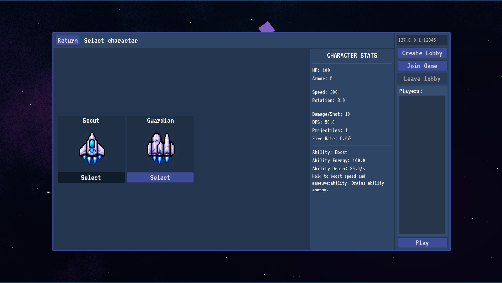
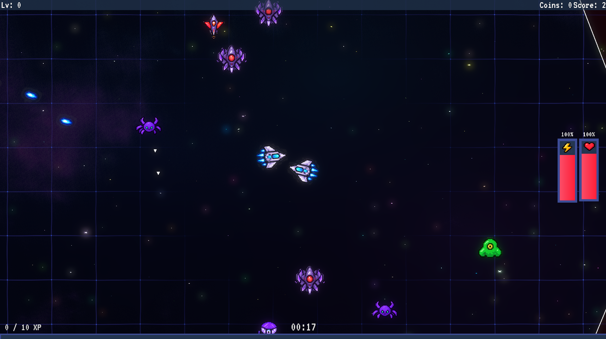

# Asteroids

Space shooter game built with Godot 4. Inspired by the classic arcade game with modern multiplayer support.

## Screenshots

| Main Menu | Gameplay |
|-----------|----------|
|  |  |

## Features

- **Multiplayer** - Host or join lobbies via IP:PORT
- **Classic gameplay** - Shoot asteroids, avoid collisions, wrap-around screen
- **Enemy ships** - AI-controlled watchers that hunt players
- **Power-ups** - Collect upgrades for weapons and shields
- **Wave system** - Increasing difficulty with each wave

## Controls

| Action | Key |
|--------|-----|
| Movement | WASD |
| Shoot | Left Click |
| Ability | Right Click |

## Running

1. Open the project in Godot 4
2. Run `scenes/main_menu.tscn` (or your main scene)
3. (Multiplayer): From the main menu: **Host** to create a lobby, **Join** to connect via IP:PORT

## Building

Export from Godot: Project → Export → Add preset → Export Project
